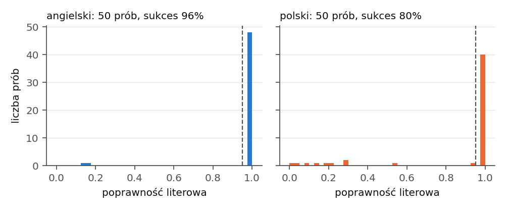
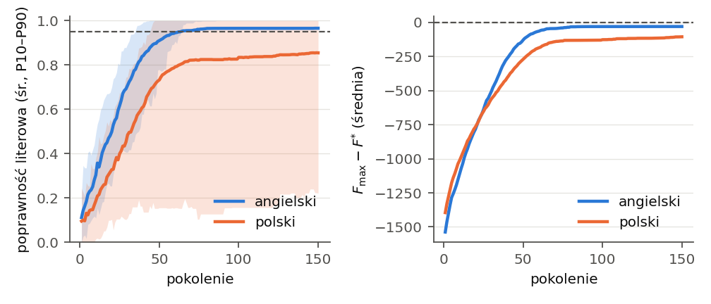
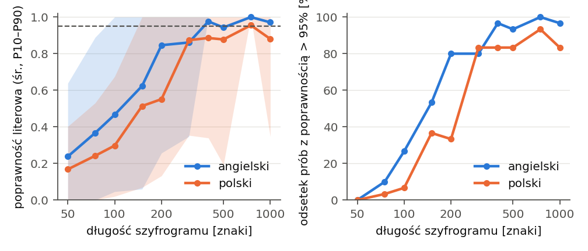
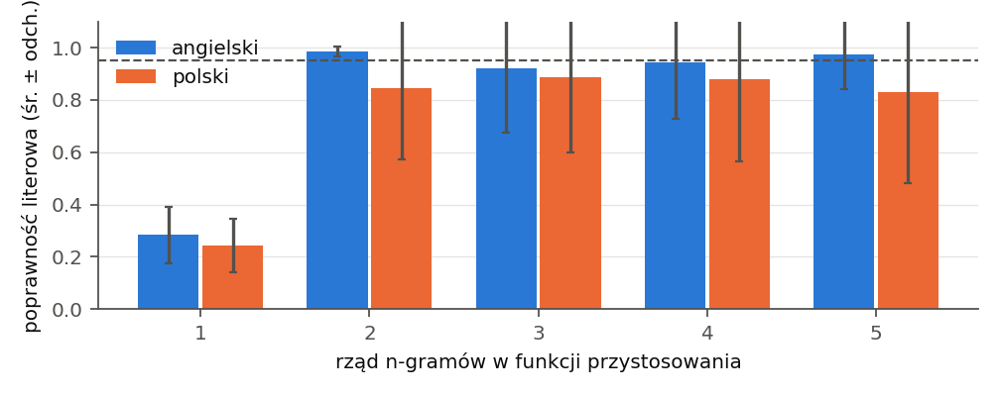

# Automated cryptanalysis of substitution ciphers with a genetic algorithm (DEAP)

A ciphertext-only attack (COA) on the monoalphabetic substitution cipher: a genetic
algorithm built with the [DEAP](https://github.com/DEAP/deap) framework searches the
space of 26! keys, and the fitness function is the log-likelihood of the decrypted
text under a 4-gram language model. The language models are estimated from
public-domain books (Project Gutenberg for English, Wolne Lektury for Polish).

## Layout

```
gasub/                 package
  data.py              book download, normalisation, train/test split, random fragments
  cipher.py            substitution cipher, letter encoding, metrics (letter and key accuracy)
  ngrams.py            n-gram model (training, .npz cache) and the fitness function
  ga.py                genetic algorithm in DEAP (PMX, swap mutation, tournament, elitism)
  experiments.py       tasks (plaintext -> ciphertext), metrics, parallel trials, JSON output
encrypt.py             CLI tool: encrypts a plaintext with a random or given key
crack.py               CLI tool: breaks a given ciphertext
run_experiments.py     experiments (main attack, length, n-gram order, spaces) -> results/*.json
figures.py             PNG figures (and LaTeX tables with --tables) from the results
examples/              example messages, their ciphertexts and transcripts of encrypt.py + crack.py sessions
results/               experiment results (JSON) and --demo transcripts
data/                  raw/ (downloaded books, cache) and ngrams/ (models) – ignored by git
report/                report.tex, PNG figures
```

## Installation

```bash
python3 -m venv venv && source venv/bin/activate
pip install -r requirements.txt
```

## Usage

```bash
# encrypt your own message (random key, spaces kept) and attack it
python3 encrypt.py --spaces -o ciphertext.txt message.txt
python3 crack.py --lang en --spaces ciphertext.txt

# break a ciphertext given inline (letters only, Polish)
python3 crack.py --lang pl "QZKTMBNJ..."

# demo: random fragment of a test book, random key, GA attack
python3 crack.py --demo --lang en --length 500

# all experiments (about 2 minutes) or selected ones
python3 run_experiments.py
python3 run_experiments.py --only main
```

## Experiments

| experiment | seeds | contents |
|------------|-------|----------|
| `main` | 0–49 | attack attempt per the project criterion: GA, 500 characters, EN and PL |
| `length` | 0–29 | ciphertext lengths from 50 to 1000 characters |
| `ngrams` | 0–29 | n-gram order 1–5 in the fitness function |
| `spaces` | 0–29 | ciphertext with visible word spaces vs letters only |

## Results

The books used to train the model and the books used for testing are disjoint.
The figures come from the report, so their axis labels are in Polish
(*angielski* = English, *polski* = Polish, *poprawność literowa* = letter accuracy).
The dashed line marks the 95 % success threshold.

### Main attack

On 50 ciphertexts of 500 characters per language, the GA (population 400,
150 generations, tournament size 5, p_c = 0.8, p_m = 0.6, PMX) meets the project
criterion in 96 % of the English trials and 80 % of the Polish ones, in about one
second per ciphertext.



*Letter accuracy of the decrypted text in the 50 trials of the main experiment
(English left, Polish right).*

Every failure is a premature convergence of the population (the true key has
a higher fitness than the key found).



*Left: mean letter accuracy of the best individual per generation, with the
P10–P90 band. Right: mean gap between the best fitness in the population and the
fitness of the true key (F_max − F\*).*

### Ciphertext length

At least 90 % success needs about 400 characters (EN) and 750 (PL).



*Left: mean letter accuracy with the P10–P90 band. Right: share of trials with
letter accuracy above 95 %. Ciphertext lengths from 50 to 1000 characters, 30 trials each.*

### N-gram order

N-gram orders 2–5 give similar results at 500 characters, while unigrams are
insufficient.



*Mean letter accuracy (± standard deviation) for n-gram orders 1–5 in the fitness function.*

### Word spaces

Visible word spaces raise the success rate to 100 % in both languages.

## Threat model (summary)

* passive adversary (eavesdropper), COA interface – only the ciphertext is known;
* Kerckhoffs's principle – the cipher, the attack code and the language model are
  public, only the key is secret (a permutation of 26 letters, |K| = 26! ≈ 2^88);
* success criterion – letter accuracy of the decrypted text above 95 % for
  a 500-character ciphertext.
